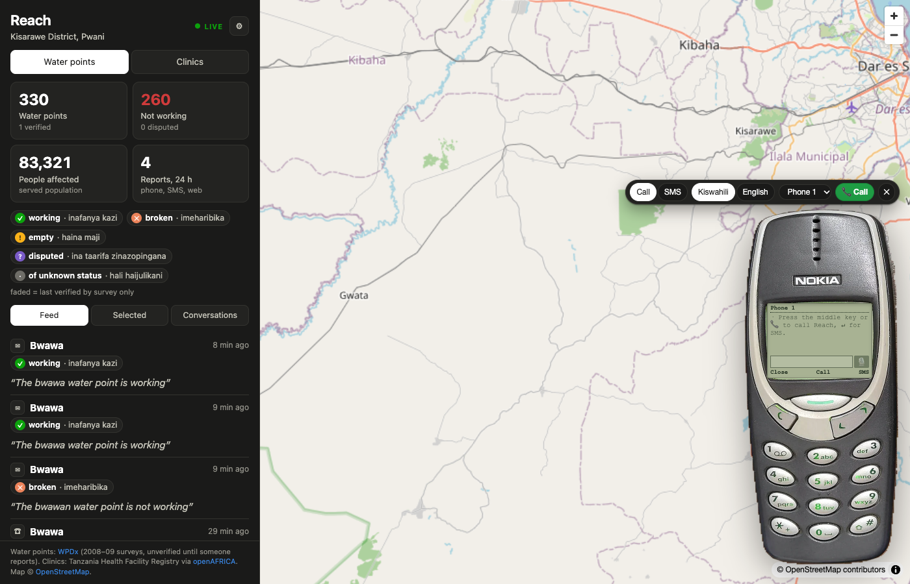

# Reach — community infrastructure knowledge platform

*Working name. Hackathon theme: Fighting World Hunger.*

Reach lets anyone report and query the status of essential community points — water points first,
clinics and nutrition centers second — through the channel they already have: a phone call or SMS in
Swahili or English, or a web map for coordinators. Reports become shared knowledge with a confidence
score, and every caller gets the answer that matters on the ground: *where is the nearest one that
works, and how far is the walk?*

Demo district: **Kisarawe, Pwani, Tanzania** — 330 real water points from the Water Point Data
Exchange (56 % non-functional at the last survey) and 16 health facilities from the national registry.

## Quick start (about 5 minutes)

```bash
git clone git@github.com:julilili42/bcg-hackathon.git && cd bcg-hackathon
make setup          # uv installs Python 3.12 + deps; npm installs the web deps
make seed           # SQLite at data/local.db: 330 water points, 16 clinics, demo aliases
make dev            # API on http://localhost:7071  (Twilio signature check off locally)
make web            # map on http://localhost:5173  (second terminal; proxies /api)
make smoke          # third terminal: replays Twilio-shaped SMS/voice requests
make rehearse       # runs the whole demo script against the API and prints PASS/FAIL per step
make check          # what CI runs: ruff, mypy, pytest (coverage ≥ 80 %), eslint, tsc, vite build
```

No Azure account, Azure Functions Core Tools, or Twilio SDK needed for any of this. Without an
Anthropic key the understanding step runs on keywords; the whole demo works that way.

### Virtual demo phone



Bottom right of the map sits a real 3310, cut out of a photo. Hover (or tap) to open it; `?phone=open`
in the URL opens it on load for the stage. The keys on the photo are clickable and work like the
original: the oblong middle key calls Reach (and sends what you typed), **C** ends the call or closes
the phone, the arrow key switches between Call and SMS, keys 1 and 2 answer follow-up questions. Type
what the caller says in the screen, or press the microphone button (Chrome speech recognition; Swahili
or English follows the call). The toolbar above the handset has the mode (Call/SMS), the greeting
language (Kiswahili/English: an English call starts in English, no need to press 2), the caller
(Phone 1/2/3, for the dispute scenario), a green **Call** button that turns into a red **Hang up**
during a call, and the close cross. Replies play as audio when the server has a voice, otherwise the
browser reads them (toggle in Settings). The same `?lang=en` works on the real webhook `/api/voice`,
so a second Twilio number could be an English line.

It posts to `/api/sim/...`, unsigned twins of the Twilio webhooks, so it keeps working while the real
number has signature validation on. `DEMO_PHONE=0` on the server disables those endpoints and hides
the phone; the gear icon in the sidebar has a per-browser "Show demo phone" checkbox.

To use another photo: `uv run --with pillow --with numpy python scripts/prep_phone_photo.py photo.jpg`
cuts the handset out, finds the screen and keys, and rewrites `web/public/phone.webp` and
`web/src/phone-layout.json`. If the image cannot load, a drawn SVG phone takes over.
`scripts/screenshot.sh <url>` takes a headless screenshot of the map to check the result.

### Optional pieces

| You want | Do |
|---|---|
| Claude for understanding garbled speech | `cp api/local.settings.json.example api/local.settings.json`, set `ANTHROPIC_API_KEY` (ask the Tech Lead; never commit) |
| A real phone | `cloudflared tunnel --url http://localhost:7071`, then `scripts/set_webhooks.sh https://<tunnel-host>`; set `PUBLIC_BASE_URL` to that URL and `TWILIO_VALIDATE=1`. One machine owns the number: the demo owner. |
| Swahili voice replies | `uv sync --extra tts && uv run scripts/download_models.py` (~300 MB, once). Or set `TTS_PROVIDER=azure` with an Azure Speech key. Without either, Twilio's own voice reads the text. |
| Fresh WPDx data instead of the snapshot | `make seed-live` |
| Reset between rehearsals | set `ADMIN_TOKEN`, then `scripts/demo_reset.sh` |

### What happens on a call

```
Call/SMS ─▶ Twilio ─▶ /api/voice (Gather, speech-to-text sw-TZ / en-US) or /api/sms
                       └▶ reach.core.service: understand (Claude or keywords) → match the point
                          → ask one follow-up only if a slot is missing (which point? did you mean X?)
                          → record the report → derive status + confidence → nearest working alternative
                       ◀─ TwiML: <Play> local/Azure TTS wav, or <Say>; SMS: <Message>
Web map: GET /api/entities (GeoJSON), /api/reports, /api/stats, /api/interactions; POST /api/reports
```

## Repository map

| Path | What |
|---|---|
| `api/reach/core/` | Channel-agnostic logic: domain configs (`domains/*.yaml`), status derivation, matching, nearest, the service loop |
| `api/reach/channels/` | Twilio voice/SMS webhooks + TwiML, web JSON API |
| `api/reach/brain/` | Claude Opus 5.5 understanding with keyword fallback |
| `api/reach/speech/` | TTS providers (none, MMS local, Azure Speech) |
| `api/reach/storage/` | SQLAlchemy Core tables and repository (SQLite locally, Azure SQL deployed) |
| `api/reach/ingest/` | WPDx, health registry, demo overlay, `seed` CLI |
| `api/function_app.py` | Azure Functions entry (ASGI wrapper around the FastAPI app) |
| `web/` | Vite + TypeScript + MapLibre map and dashboard |
| `data/` | Kisarawe snapshots and the demo alias overlay |
| `docs/` | Plan, architecture, quality gates, roles, ADRs, OpenAPI contract, pitch |
| `infra/` | Azure deployment guide and Bicep skeleton (documented, not executed) |
| `scripts/` | smoke, rehearse, set_webhooks, demo_reset, with_server, download_models |

## Read in this order

| Doc | What it answers |
|---|---|
| [`docs/00-discovery.md`](docs/00-discovery.md) | Decisions, open questions, defaults in force |
| [`docs/01-development-plan.md`](docs/01-development-plan.md) | Vision, scope, milestones, workstreams, demo script, risks |
| [`docs/02-architecture.md`](docs/02-architecture.md) | Components, domain model, data flows, contracts |
| [`docs/03-quality-gates.md`](docs/03-quality-gates.md) | Gates 0–3, definition of done, demo-readiness checklist |
| [`docs/04-roles-and-workflow.md`](docs/04-roles-and-workflow.md) | Roles, workstream ownership, git flow, parallel Claude Code sessions |
| [`docs/05-pitch.md`](docs/05-pitch.md) | Slide-by-slide pitch with speaker notes |
| [`docs/tasks.md`](docs/tasks.md) | Task board |
| [`docs/adr/`](docs/adr/) | One record per architecture decision |
| [`CLAUDE.md`](CLAUDE.md) | Rules every Claude Code session in this repo follows |

## How we work

Each teammate drives their own Claude Code session on one workstream. Contracts are agreed first,
work happens on branches, and every change reaches `main` through a pull request with green CI and
one human review. AI-generated code is a draft until a human has read and tested it.

## Secrets and personal data

Never commit credentials: `api/local.settings.json` is git-ignored. Caller numbers are stored only as
a salted hash (`REPORTER_SALT`); set a real salt before any real-phone test. Fixtures use Twilio's
magic test numbers.
